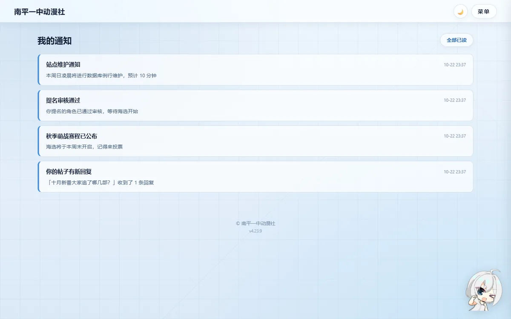

# 论坛 / 照片墙 / 通知 / 设置

## 1. 论坛

社员的讨论区，分「帖子列表 → 帖子详情（回复）」两层。

规则与实现：

| 项 | 值 | 说明 |
|---|---|---|
| 每页条数 | `BOARD_PAGE_SIZE = 20` | 分页参数 `?page=` |
| 标题上限 | `BOARD_TITLE_MAX = 120` 字 | 后端与前端都截断 |
| 正文上限 | `BOARD_CONTENT_MAX = 5000` 字 | 同上 |
| 排序 | 按"最后一条回复时间，没有回复则按发帖时间"倒序 | 有人回帖会把帖子顶上来 |
| 回复 | 帖子详情页底部固定输入框，支持自动增高 + `Ctrl/⌘ + Enter` 发送 | 移动端键盘弹起时用 `--composer-h` 变量把看板娘和内容往上顶 |
| 删除 | **作者本人可删自己的帖子/回复**；运营（staff）/站长（owner）可删任意内容 | 删主题会连带删回复与指向它的通知；删某条回复时，它下面的子回复会变成顶层 |

- 发帖 / 回复都会写 `message` / `reply` 表，并触发对帖主的通知（`reply` 类型）。
- 删除入口在页面内：「删除主题」在楼主内容下方，每条回复右侧有「删除」；都会弹确认框，POST + CSRF 防误删。
- 权限判定在后端（不是靠前端藏按钮）：作者本人或 staff/owner，其他人一律 403。
- 内容目前是纯文本 + 简单换行，**不做 Markdown 渲染**（避免 XSS；前端显示时统一转义）。

## 2. 照片墙

- 图片存 Supabase Storage 的 `photos` 桶，数据库 `photo` 表只存 URL 和元信息。
- 上传时前端先压缩（`static/js/upload-compress.js`），后端再用 Pillow 兜底压一次。
- 超过 `MAX_CONTENT_LENGTH`（默认 4 MB）会被 413 拒掉。
- 删除图片 = 删数据库记录 + 删 Storage 对象（管理员权限）。

## 3. 通知中心

| 类型 | 触发场景 |
|---|---|
| `reply` | 有人回复了你的帖子 |
| `audit` | 提名审核通过/驳回 |
| `contest` | 赛事阶段切换等系统事件（预留类型） |
| `system` | 管理员群发 |

- 导航抽屉里的铃铛显示未读数，来自 `/api/notifications/count` 轮询。
- **免打扰**（账号级，存 `preferences` JSON）：
  - `muted_types`：不想收的类型，勾掉后*不计数、不发信*
  - `email_enabled`：是否同时发邮件
  - `badge_enabled`：是否轮询红点
  - `badge_poll_seconds`：轮询间隔
- 通知里的链接用 `SITE_URL` 拼绝对地址；没配就用当前请求的 `url_root`。

!!! warning "轮询与"已读"的竞态"
    前端做"保存设置后刷新校验"时要先等一下、清空已捕获的轮询记录再断言，否则容易读到设置保存前的在途请求（e2e 踩过这个坑）。

## 4. 设置页

分四块：

1. **外观与显示**：主题（浅色/深色/跟随系统）、字号、动效开关。
2. **语言与翻译**：新闻显示语言——译文优先 / 仅原文 / 双语对照。
3. **通知与免打扰**：见上一节。
4. **数据与隐私**：清空本机偏好（`localStorage`）。

本机偏好 vs 账号级偏好的区别：

| 偏好 | 存储位置 | 换设备 |
|---|---|---|
| 主题、字号、动效、新闻语言 | `localStorage` | 不跟随 |
| 通知免打扰、红点开关 | 数据库 `user.preferences` | 跟随账号 |

未登录也能进 `/settings`（只调本机偏好），这样新访客在登录前就能选深色模式。

## 5. AI 虚拟好友

- 见 [番剧资源 / 番剧百科 / 新闻 / AI 好友](anime.md)。
